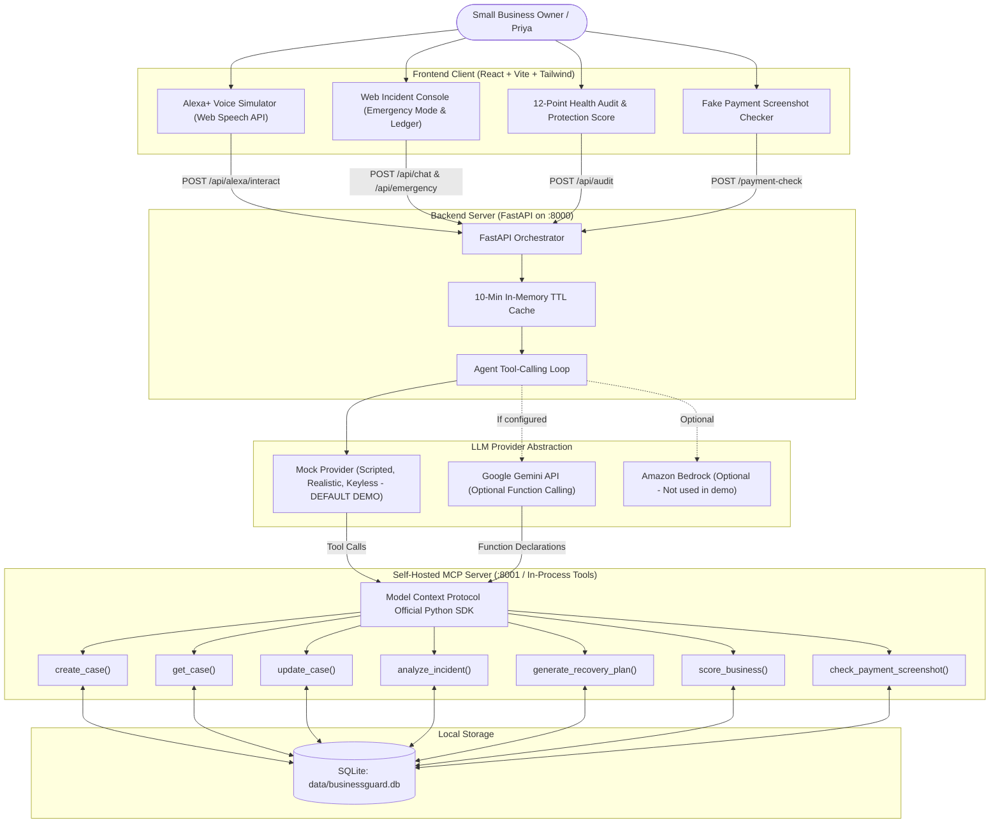

# BusinessGuard AI 🛡️

> **"Your business's first responder."**  
> *Sub-line: "Hacked, scammed or threatened? Get a calm, step-by-step rescue plan by voice or on screen."*

[](LICENSE)
[](https://python.org)
[](https://fastapi.tiangolo.com)
[](https://modelcontextprotocol.io)
[](https://vitejs.dev)

---

## 📌 Problem Statement

Millions of small businesses and solo creators across Instagram, WhatsApp, and social commerce platforms operate without dedicated IT departments, legal teams, or cyber security defense. When an Instagram account with 30,000 followers gets hijacked through a phishing DM, or a buyer intimidates an owner with a forged UPI screenshot or a fake consumer legal notice, the business owner panics. 

Existing cybersecurity tools are built for enterprise SOC teams with complex dashboards and technical jargon. Meta and platform support ticket queues often take days to respond—while attackers exploit the first 60 minutes to defraud the seller's followers.

**BusinessGuard AI** serves as the **calm, intelligent first responder**. An owner can trigger a rescue by voice through a simulated Alexa+ experience, receive an immediate Case ID (e.g. `BG-2026-005`), and continue the rescue seamlessly on screen with their full 24-hour containment plan, cyber cell evidence checklist, and Business Protection Score.

> **Transparency Note:** BusinessGuard AI is a hackathon prototype. The Alexa+ hardware experience is simulated in the browser, and all seed data represents realistic sample cases. General guidance only, not formal legal advice.

---

## 🏗️ Architecture Diagram



---

## ⚡ Quick Setup (5 Commands or Fewer)

Everything runs locally for free without requiring paid subscriptions or external databases:

```bash
# 1. Clone repository & navigate
git clone https://github.com/sejalheda/BusinessGuard_AI.git && cd BusinessGuard_AI

# 2. Set up Python virtual environment & install backend packages
python -m venv .venv && .\.venv\Scripts\activate && pip install -r requirements.txt

# 3. Install frontend dependencies
cd frontend && npm install && cd ..

# 4. Copy environment configuration (Default: LLM_PROVIDER=mock)
cp .env.example .env

# 5. Start the full application (Run Backend & Frontend in separate terminals)
# Terminal 1: Backend Server
.\.venv\Scripts\python -m uvicorn backend.app.main:app --port 8000 --reload
# Terminal 2: Frontend Web App
cd frontend && npm run dev
```

Open **http://localhost:5173** in your browser.

---

## 🤖 How AI is Used & Provider Abstraction

The backend implements a clean provider abstraction interface in `backend/app/llm/base.py`:
```python
async def chat(messages: list[dict], tools: list[dict], system_prompt: str) -> LLMResponse
```

Three selectable providers are implemented via `LLM_PROVIDER`:
1. **`mock` (Default used in demo — 100% Free & Keyless):** Fully scripted, realistic, and intelligent responses tailored specifically to social sellers. Simulates MCP tool execution, generates structured output cards, and requires **no external API keys or paid services**.
2. **`gemini` (Optional):** Powered by Google's Gemini models using `GEMINI_API_KEY`. It supports native function calling matching our MCP tool schemas, as well as vision-based visual warning sign inspection in the Fake Payment Screenshot Checker.
3. **`bedrock` (Optional — Not used in demo):** Present in the codebase as an optional integration using Amazon Bedrock Converse API (`boto3`). It is optional, unconfigured by default, and not used in the demo.

### Automatic Graceful Fallback
If `gemini` is selected but fails due to a missing API key, network timeout, or free-tier rate limit, the system **automatically falls back to `mock`** and displays a discreet `"Using demo responses"` badge in the UI. **Raw exceptions or API failures are never exposed to the merchant.**

### 10-Minute Free-Tier Rate Limiting Cache
Identical requests are cached in-memory with a 10-minute TTL to stay comfortably inside free-tier rate limits.

---

## 🛠️ Self-Hosted MCP Server Tools (`/mcp_server`)

BusinessGuard hosts a dedicated Model Context Protocol server built with the official `mcp` Python SDK:
- **`create_case(incident_type, details)`**: Initializes a new incident in SQLite and returns incrementing Case ID (`BG-2026-XXX`).
- **`get_case(case_id)`**: Retrieves full case timeline, severity, and answers.
- **`update_case(case_id, patch)`**: Updates status (`open`, `in_progress`, `resolved`), turns, completed recovery steps, or recovery plans.
- **`analyze_incident(case_id)`**: Assesses threat vectors, urgency, affected platforms, and visible reasoning checks.
- **`generate_recovery_plan(incident_type, severity)`**: Emits 3-phase timeline (`first_hour`, `first_24h`, `first_week`), immediate actions, 24-hour containment, cyber cell evidence checklist, and hardening tips.
- **`check_payment_screenshot(image_b64, filename)`**: Analyzes payment proof screenshots for typography artifacts, clock/timestamp disparities, and bank ledger absence.
- **`score_business(audit_answers)`**: Evaluates 12 health audit responses across Legal, Security, Operations, and Brand hygiene.

You can inspect all tool definitions and execute live tests at the `/mcp/tools` UI page or `http://localhost:8000/mcp/tools`.

---

## 🌟 Key Features & Capabilities

### Tier 1 Core Capabilities
1. **Alexa to Web Case Handoff (Signature Feature):**
   - Glowing cyan-blue Echo ring with realistic `idle`, `listening`, `thinking`, and `speaking` states.
   - User speaks or types: *"Alexa, ask BusinessGuard, my Instagram was hacked."* Wake phrase is stripped before processing.
   - Alexa asks 3 rapid follow-up questions, speaks immediate actions aloud, generates an incrementing Case ID (e.g. `BG-2026-005`), and saves it to SQLite.
   - Clicking **"Continue on Web App"** or entering the Case ID in the top bar instantly resumes the incident with a **"Continued from Alexa"** banner.
2. **AI Business Advisor:**
   - Real-time chat with structured assessment cards: Risk Level, Situation Analysis, Recommended Actions, and Prevention Tips.
3. **Emergency Mode:**
   - Big red emergency button instantly shifts the app into a dramatic red theme with a pulsing alert while a critical case is active.
4. **12-Point Business Health Audit:**
   - One question per screen with progress tracking across registration, GST, MFA, invoices, trademark, password vault, and cyber insurance.
5. **Business Protection Score Dashboard:**
   - Animated SVG circular gauges for Legal, Security, Operations, and Brand.
   - Large overall resilience score (e.g. 68/100).
   - 6-week trend line chart (*labeled Sample data*) and Top 3 fixes that raise the score the most.
6. **Case Ledger:**
   - Searchable, filterable ledger seeded with realistic cases (`BG-2026-001` through `BG-2026-005`) plus live cases created during voice sessions.

### Tier 2 Extended Capabilities
1. **Visible Reasoning Panel ("Why this verdict"):**
   - Collapsible panel on Case Detail, Advisor answer cards, and Emergency results.
   - Lists the specific checks the agent ran and the concrete evidence behind the severity verdict.
   - Each check displays a confidence chip (Low, Medium, High) and the underlying MCP tool that generated it, appearing with a smooth staggered animation.
   - Persisted in SQLite with the case so reasoning is preserved across reloads.
2. **Fake Payment Screenshot Checker:**
   - Dedicated page with drag-and-drop file upload for PNG or JPG receipts up to 5 MB with instant preview.
   - Powered by Gemini vision analysis with automatic fallback to scripted heuristic analysis.
   - Displays a dynamic risk meter (High, Medium, Low), detailed visual warning signs (font anomalies, timestamp mismatches, missing bank ledger records), and a 4-point bank verification checklist.
   - One-click **"Create a case from this"** button immediately registers a Fake Payment Fraud incident with attached findings.
   - Uploaded screenshots are processed strictly in-memory and never stored permanently on disk.
3. **Risk Radar:**
   - Home page defense widget with 4 real-time exposure rows: **Cyber**, **Fraud**, **Legal**, and **Brand**.
   - Dynamically derived from the merchant's latest Health Audit answers and open incident cases (e.g., an open hacked account case raises Cyber to High; missing trademark raises Brand).
   - Shows clear Low, Medium, or High status chips with animated progress bars, and each row is clickable to display a plain-English explanation.
4. **3-Phase Recovery Timeline with Interactive Ticks:**
   - Every emergency case presents a structured 3-phase roadmap: **First hour (0-60m)**, **First 24 hours**, and **First week**.
   - Merchants tick completed steps as they recover; ticking animates the circular progress ring, logs a timestamped turn in the case ledger, and triggers a floating **+2 Protection Score** boost that immediately reflects on dashboard gauges.
   - Reaching 100% completion reveals a celebratory banner and enables one-click case resolution.
5. **QR Code Handoff & Direct URL Routing:**
   - On Alexa case creation, renders a large 160x160 px QR code (`qrcode.react`) and a one-click **"Copy link"** button with visual confirmation.
   - Direct URLs formatted as `/cases/:id` (e.g. `http://localhost:5173/cases/BG-2026-005`) work seamlessly on first load or refresh, displaying the **"Continued from Alexa"** verification banner.

---

## 🗺️ Roadmap

- [ ] **WhatsApp Business Webhook Integration:** Live inbound messaging support for merchants who cannot use voice.
- [ ] **Automated Meta Graph API Account Dispute:** One-click pre-filled PDF submission to Meta Intellectual Property & Account Recovery portals.
- [ ] **Indian Cyber Crime Portal (cybercrime.gov.in) Exporter:** Formats incident timestamps, screenshot hashes, and UTR numbers into official complaint templates.
- [ ] **Multi-Merchant Team Roles:** Support for multi-user boutiques with granular permission controls.

---

## 📜 License

This project is licensed under the MIT License - see the [LICENSE](LICENSE) file for details.
